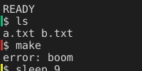

# 外观：光标闪烁、命令标记与主题复位

本批补 F13 里三项与“外观可调”直接相关、又不牵涉 GPU 与平台特性的能力：可选的**光标闪烁**、**命令成功/失败标记**和**回到配置主题**的动作。透明度、模糊、标签/侧栏样式、图标回退与可读性选项仍在 F13 未完成列表里。

## 1. 光标闪烁

### 配置

```toml
[appearance]
theme = "dark"
# 默认 false：静止界面不为光标持续重绘
cursor-blink = false
```

### 行为

- 只影响**光标的绘制**：`Renderer::draw` 多一个 `cursor_on` 参数，为 false 的那一帧不画光标（实心块和失焦时的空心框都不画）。
- 相位由 `blink_anchor` 决定：亮 530 ms、灭 530 ms。以下情况把锚点重置到“现在”，也就是立刻回到亮相位：
  - 按键、文本、输入法预编辑、粘贴；
  - 会话有新输出（`tick` 里 `update.changed`）。
  这样用户敲字时不会正好撞在灭相位上看不见光标。
- 下列情况**不闪烁**，光标常亮：配置关闭、窗口失焦、搜索栏或通知浮层打开。
- 事件循环：`App::deadline` 在闪烁时给出下一次相位翻转的时刻，`App::needs_redraw` 在相位翻转时返回 true，因此即使没有输出也会按时醒来重画。

### 代价

- 没有新增线程、子进程或常驻分配；`blink_anchor`/`last_cursor_on` 是 App 上的两个小字段。
- 闪烁开启时每 530 ms 一次重绘，**只重画光标所在的那一行**：行指纹里含光标状态，逐行比较后只有一行变化。实测 728×416 的窗口两帧之间只有 9×17 像素（正好一格）不同。
- 关闭时（默认）完全不加唤醒时刻，静止界面依旧零重绘。

## 2. 命令成功/失败标记

### 配置

```toml
[appearance]
# 需要 shell 集成上报 OSC 133；关掉就不画色条
command-marks = true
```

默认开启：只有 shell 集成交互（OSC 133 的 A/B/C/D 序列）才会产生标记，所以对没配置 shell 集成的用户没有任何可见变化。

### 行为

- 每条**已结束**的命令在它的提示行最左侧画一条竖色条，高度是格子高度减 2 像素，宽度取格子宽度的 1–3 像素，位置落在左内边距里，不压住第一个字。
- 颜色取自当前主题的调色板：成功（退出码 0）绿、中断（130/143）黄、其他退出码红。
- 退出状态未知（`D` 没带退出码）时**不画**，避免把“不知道”画成“成功”或“失败”。
- 提示行用稳定行号（`Terminal::line_id`）匹配，往回翻历史时标记跟着行走；行被历史淘汰后命令记录也被 `prune` 清掉，不会画到错的行上。

### 代价

- 没有新增线程、子进程或缓存；不占用 `ui::State` 的装饰缓冲，避免和搜索高亮抢额度。
- 每画一行做一次二分查找（`Shell::outcome_at`，命令按提示行升序保存，最多 1024 条），不扫描全部历史。
- 行指纹包含该行的标记状态，命令结束时即使文本没变也只重画那一行。

## 3. 主题复位（`reset-theme`）

`Primary+F6` 的循环切换会改 `Config::theme`，但配置文件里的值不受影响。新增：

- `Config::theme_default`：解析配置时记下 `[appearance] theme`（默认 dark）。
- `Config::reset_theme()`：把 `theme` 设回 `theme_default` 并重新计算颜色覆盖。
- `Action::ResetTheme`，动作名 `reset-theme`，**没有默认键位**，需要自己绑定（例如 `F5 = "reset-theme"`），避免占用更多组合键。

复位后立即调用 `renderer.apply_style`，配色、界面颜色与终端调色板一起更新；`[colors]` 里显式覆盖的值仍然保留（与循环切换的语义一致）。

## 4. 测试

| 测试 | 覆盖 |
|---|---|
| `render::boundary_tests::blink_phase_decides_whether_the_cursor_is_painted` | `cursor_on=false` 不画光标；切回亮相位画面还原；失焦的空心框同样受控 |
| `integration_tests::cursor_blink_phase_follows_configuration_and_input` | 默认关闭（无唤醒时刻、不需要重绘）；开启后相位翻转触发重绘；按键立刻点亮并重新计时；失焦停止闪烁 |
| `render::boundary_tests::command_marks_paint_a_result_bar_in_the_left_padding` | 失败红、成功绿、中断黄；关掉 `command-marks` 后不再画 |
| `integration_tests::command_marks_show_each_result_in_the_left_margin` | 应用层三条命令的色条在左边缘依次出现，顺序与结果一致 |
| `shell::tests::outcome_at_finds_the_mark_for_a_prompt_line_only` | 二分查找到提示行才返回结果；越界或不在文本里的行号返回 None |
| `integration_tests::reset_theme_action_restores_the_configured_theme` | 按动作名绑定 F5，循环到别的主题后按 F5 回到 midnight，且配色确实变了 |
| `config::tests::appearance_parses_cursor_blink_and_reset_returns_to_the_configured_theme` | `cursor-blink` / `command-marks` 的解析与默认值；`reset_theme` 回到配置值而不是编译默认；键名进了 schema |

## 5. 未验收

- 只在 Linux 上运行过测试与预览帧；macOS/Windows 只做了交叉 clippy，不算真机验证。
- 主题预览面板（切换前先看效果）没有做，F13 里“提供主题预览和恢复默认”只完成了“恢复默认”。
- 标签/侧栏/状态栏样式、图标回退、可读性选项（对比度/字重）仍是待办。
- 命令标记只有一种样式（左边缘竖条），F13 说的“命令标记样式”还不支持换样式或换成图标。
- 透明度与模糊未做。

## 6. 预览

命令标记（成功绿、失败红、中断黄）在提示行左侧的样子：


