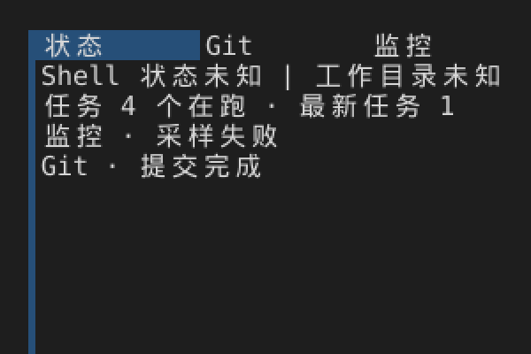

# 通知中心：来源接入、去重限速与定位

本轮把 Git、监控与 SFTP 写操作接进已有通知中心，并补上“从通知跳回相关页面”的入口。命令完成/失败、会话结束与传输结局在 M3/M6 已接入，本文只记录本轮新增部分与它们的共同管线。

## 事件来源

| 来源 | 触发 | 文案（应用内） | 系统横幅（ASCII 模板） |
| --- | --- | --- | --- |
| `Source::Command(id)` | 命令完成/失败、长命令、后台结束 | 原有文案 | `... failed`/`completed` |
| `Source::Session` | 会话结束 | 原有文案 | 原有模板 |
| `Source::Transfers` | 传输结局（`sftp-preview` 构建） | 原有汇总文案 | 原有模板 |
| `Source::Git` | 暂存、取消暂存、提交成功或失败 | `Git · 暂存完成` / `Git · 提交失败` | `Git: write completed` / `failed` |
| `Source::Monitor` | 采样从正常转为失败（平台不支持、额度不足、任务失败） | `监控 · 采样失败` | `Monitor: sampling failed` |
| `Source::Sftp` | 远程新建目录/重命名/删除成功或失败（`sftp-preview` 构建） | `SFTP · 删除失败` | `SFTP: remote write completed` / `failed` |

细节约束：

- 应用内文案只用固定动作词（暂存、提交、新建目录、重命名、删除），**不含路径、分支名或提交正文**；系统横幅只用 ASCII 模板，避免 Windows 上的编码问题。
- 远程写操作的“用户主动取消”不算失败，不进通知中心（面板状态行仍有提示）。
- 监控只在错误从“无”变“有”时报一次；同一次失败持续期间不重复上报，恢复后再次失败会重新上报。

## 管线

1. **来源开关**：`Settings` 里的 `git`、`monitor` 复用 `transfers`，`muted` 全局静音。被关掉的来源直接丢弃，不排队、不补发。
2. **固定窗口限速**：10 秒内最多 `burst`（默认 12）条进入本地记录；超出只累加 `throttled` 计数，状态栏显示“限速丢弃N”。
3. **同类合并**：`Git`、`SFTP`、`Monitor` 这三类无载荷事件，同来源 + 同类别 + 同动作词且间隔小于 `dedupe-seconds`（默认 5）时合并成一条并累加 `repeat`，文案追加 `×N`。命令与传输带载荷，不参与合并。
4. **系统横幅**：真正入列的通知才走 `SystemGate` 的 10 秒闸门与既有后台 helper（5 秒超时、取消即 kill）。系统通知默认关闭（`system = false`）。

记录仍是固定的 128 槽环形窗口，首次准入、满后复用、`clear()` 释放；额度走既有的 notifications 资源项。

## 定位入口

- **单窗口**：`Primary+F10` 打开通知浮层，↑/↓ 浏览，**回车**跳到该条通知对应的命令输出（复用命令选择与复制路径，不新开解析），Esc 关闭。工作区面板类通知在单窗口下没有对应页面，回车只给出提示。
- **工作区**：右栏“状态”页列出最近 8 条通知，并记下每条的行号与来源；**点击某条通知行**即切到对应页面——Git 通知切到 Git 页并重新申请额度，监控通知切到监控页并恢复采样，SFTP/传输通知切到左栏文件页。点击行本身不重复触发事件。

## 配置

```toml
[notifications]
git = true            # Git 写操作结局
monitor = true        # 监控采样失败
transfers = true      # 传输与 SFTP 远程写操作
muted = false
system = false
dedupe-seconds = 5    # 0 视为 1，同类事件在该窗口内合并
burst = 12            # 10 秒窗口内的本地通知上限，至少 1
```

## 测试

- `notifications::tests`：同类合并与 `×N`、限速计数与不补发、按来源静音、SFTP 文案与 ASCII 系统模板、`current()`/`recent_notices()` 顺序（18 项含传输侧）。
- `workspace::tests::git_panel_stages_and_commits_through_the_sidebar`：真实仓库暂存与提交后，通知中心出现 `Git · 暂存完成` 与 `Git · 提交完成`，且文案不含文件名与提交正文。
- `workspace::tests::status_page_notice_rows_jump_to_the_related_page_and_monitor_failure_is_reported_once`：状态页点击 Git 通知行切到 Git 页并重新打开面板；监控失败只上报一次。
- `workspace::tests::monitor_failure_notice_fires_once_per_failure_and_rearms_after_recovery`：失败持续不重复、恢复后重新置位。
- `integration_tests::command_navigation_copy_notifications_and_focus_use_the_same_session`：浮层回车定位到命令输出并关闭浮层。

## 预览



1200×700 窗口、右栏 280 px 时“状态”页的样子：第三行是任务数，第四行起是最近通知；点击 `Git · 提交完成` 那一行会切到 Git 页。

## 未验收

- 按主机静音（现在只有按来源类别静音）。
- 命令正文、远程路径的“隐藏敏感上下文”选项与通知日志清理界面（M8 另一条）。
- 真实系统通知权限、送达与峰值内存（M3 遗留，需要真机）。
- 工作区模式下没有通知浮层，只有状态页的行；键盘浏览浮层仍只在单窗口可用。
