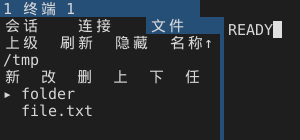

# SFTP 远端写操作与目录排序（M6：新建目录、重命名、删除、排序）

左栏“文件”页的 SFTP 目录视图新增三个远端写操作和一个本地排序开关。所有写操作都由用户显式点击或按键触发，走既有 Service 队列、预算、取消与认证流程，不新增线程、子进程或后台设施；排序只在已准入的条目集合上原地重排，不发额外请求（切换后按同一目录重读一次）。

平台范围：SFTP 服务层本就是 Unix 专用（`src/sftp/service.rs` 以 `cfg(unix)` 编译），因此写操作函数（`operations::mkdir/rename/remove`）与本地 `sftp-server` 互操作测试同样只在 Unix 构建中编译；Windows/macOS 交叉编译仍通过 `cargo check` 与 `clippy -D warnings`，只是不含这条写路径。

## 入口、配置与快捷键

| 项目 | 值 |
| --- | --- |
| 入口 | 左栏“文件”页（SFTP 目录视图），操作行（行 3）六个槽位 |
| 按钮 | `[新建]` `[改名]` `[删除]` `[上传]` `[下载]` `[任务]` |
| 前置条件 | 已有远端目录视图；`改名`/`删除` 需要先选中条目 |
| 名称输入 | `Enter` 提交、`Esc` 取消、`Backspace`/`Delete` 删除、`←`/`→` 移动、`Home`/`End` 跳到首尾；可打印字符按 `Event::Text`（macOS 输入法）或 `Key::Char`（X11/Windows 直键）进入输入框，带 Ctrl/Command 的组合键不进；输入期间键盘不进终端 |
| 删除确认 | `Enter` 执行删除、`Esc` 取消；行 2 显示 `删除目录 主机:绝对路径` |
| 关闭 | 关闭右栏/切换左栏页/窗口失焦都会取消在途写任务并清空输入与确认 |
| 排序 | 行 1 第四个槽位（`上级` `刷新` `隐藏` 之后）；每点一次在 `名称↑`→`名称↓`→`大小↓`→`时间↓` 间循环，目录恒在文件前面，同键按名字兜底 |

按钮标签按每槽可用显示列自动降级：完整 `[新建]` → 双字 `新建` → 单字 `新`，避免窄侧栏把标签裁成半个词。SFTP 页沿用既有 `[sftp]` 配置与 `sftp-preview` 入口，本批不新增配置项。

## 正常流程

1. 目录视图加载完成后，操作行显示六个按钮。
2. `新建`：行 2 变成 `新目录名 › `，输入名称后 `Enter` 在当前目录下创建。
3. `改名`：先选中条目，点 `改名`，行 2 变成 `新名称 › 原名`，`Enter` 把所选条目改成输入的名称。
4. `删除`：先选中条目，点 `删除`，行 2 变成 `删除目录/删除文件 主机:绝对路径`，`Enter` 才真正下发（两次确认，且目标主机与路径同时可见）。
5. 提交后行 3 显示 `正在等待远端确认：新建目录/重命名/删除…`，其余按钮不接受点击。
6. 成功后自动重读当前目录并给出通知（`已创建目录`/`已重命名`/`已删除`）；失败保留原列表并在错误行显示服务端错误。
7. `排序`：点击后模式前进一格，状态栏提示 `目录排序：名称↓`，并按同一目录重读一次；新结果按该顺序显示，切换目录后模式保持。

## 取消、超时、失败、超限与关闭

| 情况 | 行为 |
| --- | --- |
| 输入阶段按 `Esc` | 关闭输入，不产生任何远端请求 |
| 确认阶段按 `Esc` | 关闭确认，不删除 |
| 提交前已有在途写任务 | 返回 `Failure::Cancelled`，不排队第二个 |
| 名称非法（空、含 `/`、`.`、`..`、含 NUL、超 1024 字节） | 本地拒绝为 `Failure::Invalid`，不触网；超长输入在录入时即丢弃 |
| 服务层校验（相对路径、`/`、`/a/..`、超长名、`rename` 源目标相同） | `Failure::Invalid`，不排队（`src/sftp/service.rs::mutation_path`） |
| 额度不足 | 名称输入按 `size_of::<NameInput>() + 2×1024 + 256` 申请 `Kind::Sftp` 票据，写任务按 `size_of::<Mutation>() + 128` 申请；失败报“额度不足”，不排队 |
| 需要认证（口令/主机校验） | 复用同一前台认证覆盖层，认证完成后写任务才继续；取消认证即取消写任务 |
| 超时 | 每个写任务 `Duration::from_secs(10)`，超时由 Service 取消票据 |
| 连接关闭/回收 | 面板切到 `Failure::Connection`，写任务随 Service 关闭一起取消 |
| 删除非空目录 | 服务端返回错误（`Rmdir` 不递归），目录内容保留，面板显示错误 |
| 重命名目标已存在 | 不替换（`replace = false`），返回服务端错误，原目标内容保留 |
| 清理残留临时文件 | 第一次点击只起 10 秒确认窗口，第二次才提交删除；窗口过期、换选记录或关闭面板都不删 |
| 关闭应用 | 在途写任务取消，票据归还，`Drop` 不重试 |

## 后台任务、线程、子进程、缓存与数据所有权

- 不新增线程：写请求进入既有 SFTP Service（2 活动 / 64 等待 / 16 MiB 子池），完成结果由既有 `service.take()` 在 `sftp_tick` 中取出。
- 不新增子进程：仍由 helper/OpenSSH 会话承载；helper 缺失时立刻失败为 `Failure::Authentication`。
- 缓存：只有一个 `Mutation` 槽位（票据、绑定、认证句柄、操作类型、来源、额度票据）；清理残留复用同一槽位，不额外占额度；名称输入上限 1024 字节、预编辑 256 字节，均按 `Kind::Sftp` 计费。没有跨请求缓存。
- 数据所有权：`Workspace` 持有 `remote_files::State`；`State` 持有 `form`/`confirm`/`mutation`；`Mutation` 持有 `Ticket` 与 `Authentication`；Service 持有实际请求与结果。成功后的目录重读走既有 `submit_remote_directory`，票据仍是原目录票据。
- 认证归属：`Mutation.binding` 与目录视图同源（窗格 id、profile、generation），换窗格/换配置档后的迟到结果直接丢弃。

## 残留临时文件

上传先把内容写到目标目录下的 `.congminal-<32 位十六进制>.part`，确认长度后再改名成目标名。取消、失败或提交结果不确定时，这个临时文件可能留在远端；传输记录会记下它的完整路径（`transfer_state::Status::partial`）。

- 列表：任务结束后若还记着临时文件，金额行末尾出现 `· 残留`。
- 详情：`[详情]` 的报告里有一行「部分文件候选（不保证存在）：<完整路径>」，这是唯一显示完整路径的地方（侧栏只有 30 列左右）。
- 清理：选中该记录后第三行出现 `[清理]`，第一次点击把按钮变成 `[确认]` 并起 10 秒窗口，第二次点击才提交一次 `remove`（只删这一个路径，不递归、不碰目标文件）；成功后记录上的临时路径被清掉、提示「已删除残留临时文件」，失败则提示原因且记录保留。
- 边界：`[清理]` 只在记录已结束且有临时路径时可用；没有残留时按钮不可点。确认窗口过期、换选到别的记录、面板关闭都会作废确认。清理走的是文件页删除同一条 `Action::Remove` 通道，因此同样受 `mutation_path` 校验、10 秒超时与连接关闭取消约束。

## 协议层与薄适配

`src/sftp/operations.rs` 新增三个函数，全部复用既有 `Request`/`Expected` 通道：

- `mkdir(path)` → `Request::Mkdir`，`Expected::Status`，只接受 `code == 0`。
- `rename(from, to)` → `Request::Rename { replace: false }`，不覆盖既有目标。
- `remove(path, directory)` → `PathOp::Rmdir` 或 `PathOp::Remove`，不递归。

出错时通道 `abort()`（与既有目录操作一致），由上层映射为 `Failure::Remote(code)`。没有引入新的 SFTP 扩展或库依赖。

## 目录排序

排序是本地行为，不改协议：`Action::Directory { path, hidden, sort }` 把模式带进工作器，`Scan::finish` 在已准入的条目上原地 `sort_unstable_by`（不额外分配、不增加条目上限），结果仍是同一个 `Listing`。

| 模式 | 比较键 | 说明 |
| --- | --- | --- |
| `名称↑` | 名称字节升序 | 默认；与既有一致 |
| `名称↓` | 名称字节降序 | 目录仍在前 |
| `大小↓` | `attrs.size` 降序 | 缺属性按 0 处理 |
| `时间↓` | `attrs.times.1`（mtime）降序 | 缺属性按 0 处理 |

四种模式都先按“目录在前、文件在后”分组，同键再按名称升序（`名称↓` 按降序），因此结果稳定可复现。排序槽的标签按每槽可用显示列降级：`排序·名称↑` → `排序名↑` → `名称↑` → `名↑`，窄侧栏不会出现半截词。模式只存在面板状态里（`State::sort`），不写配置文件；切换窗格或关闭面板后回到默认 `名称↑`。

原生（`sftp-libssh2`）后端的目录读取尚未接排序选项，始终按名称排序；OpenSSH 后端（默认路径）已接。

## 测试

```
cargo test --locked remote_files          # 面板逻辑、输入上限、键盘归属、窄栏裁切
cargo test --locked service_prepare       # 服务层参数校验（不触网）
CONGMINAL_TEST_SFTP_SERVER=/usr/lib/openssh/sftp-server \
  cargo test --locked local_subsystem_creates_renames_and_removes_entries -- --ignored
cargo test --locked directory_sort                 # 四种排序模式的条目顺序
cargo test --locked sort_button_cycles             # 面板点击换档、重读与状态栏提示
cargo test --locked residual_temp_file             # 残留标记、二次确认、清理提交与额度归还
cargo test --locked cleanup_confirmation           # 确认窗口过期与换选记录作废
cargo test --locked forgetting_the_partial         # 清掉记录后不再提示残留
CONGMINAL_TEST_SFTP_SERVER=/usr/lib/openssh/sftp-server \
  cargo test --locked local_subsystem_sorts_directory_entries_the_way_the_panel_asks -- --ignored
```

覆盖：字符经 `Key::Char` 进入名称且 Ctrl 组合被忽略、新建目录成功与重名失败（失败后通道失效）、重命名成功与目标已存在不覆盖、删除文件/空目录成功与非空目录被拒、提交后额度归零；面板侧覆盖无选中时改名/删除被拒、删除确认行含主机与路径且 `Esc` 不留任务、名称 1024 字节封顶与非法名称本地拒绝、合法名称进入在途任务并在 helper 缺失时留下 `Failure::Authentication`、输入期间键盘不写入终端、窄侧栏保留名称末尾。

残留覆盖：结束且记录了临时文件的记录才启用 `[清理]`，没有残留时不可点；第一次点击只起确认窗口、不提交任务，第二次点击提交 `Action::Remove`（`Origin::Cleanup(记录)`）；确认窗口过期后点击不会删除而是重新起窗口；换选记录后确认作废；`Status::forget_partial` 清掉后不再显示残留。

排序覆盖：`Scan::finish` 在合成 NAME 页上对四种模式逐一比对顺序（含目录在前、同键按名字）、按钮循环顺序；面板侧点击四次逐档核对 `State::sort`、状态栏提示与“视图换成在途状态”（旧结果不会冒充新顺序）；本地 `sftp-server` 互操作测试按 `名称↑`/`名称↓`/`大小↓`/`时间↓` 读取真实目录并核对顺序。

手工验证（Linux 本机已核对）：

```
CONGMINAL_SFTP_OPS_PREVIEW_PATH=/tmp/ops.ppm \
CONGMINAL_SFTP_FORM_PREVIEW_PATH=/tmp/form.ppm \
CONGMINAL_SFTP_DELETE_PREVIEW_PATH=/tmp/delete.ppm \
cargo test --locked name_input_is_bounded
```

三帧分别为操作行、名称输入、删除确认；窄侧栏下按钮降级为单字，确认行保留路径末尾（`删除目录 fix…/tmp/folder`）。

行 1 的排序槽在 280 px 侧栏下显示当前模式（截图为 `名称↑`）：



## 已知限制与未验收项

- 仍只在 `sftp-preview`/测试构建中可用，默认发布入口未打开（与既有 SFTP 面板一致）。
- 没有递归删除、批量删除、拖拽移动、上传覆盖同一批的远端覆盖确认；删除只做单条目。
- 重命名只改名称，不支持跨目录移动（目标恒为当前目录）。
- 写操作没有进度条：远端确认期间只显示等待提示，长延迟目录只能等超时。
- 残留清理一次只处理一条记录，也不清理“记录已被清除”后留下的临时文件（清除记录不会删除文件，这是既有约定）；下载的本地暂存残留同样不在本批范围。
- 清理成功后只清掉记录上的标记，不再回读目录；远端若同时有同名新文件，由用户在文件页确认。
- 排序模式不落盘（重开面板回到 `名称↑`），也没有“按扩展名/权限”排序；切换模式会重读一次目录，超大目录仍受既有 512 项/8192 次扫描上限约束。
- 真实 SSH 主机回环（自建 sshd + helper）未验证：本机没有 `sshd`，只有 `sftp-server`；协议层与面板层分别用本地子系统和合成目录验证，不能替代真机验收。
- Windows 未运行；交叉编译不算真机验证。
