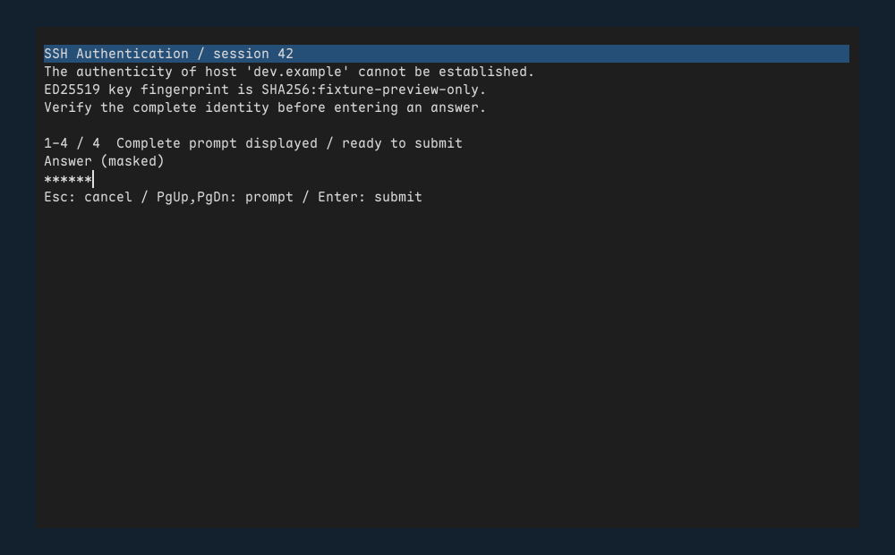

# 长提示视口与认证绘制组件

`ssh/auth_viewport.rs`、`auth_view.rs` 和测试渲染入口已接通 Editor。当前可生成真实软件绘制的面板，尚未连接工作区事件/SFTP 控制器或默认运行路径；不能把预览当作原生认证窗口已经交付。没有新增包、后台线程或定时器。

## 布局与交互边界

视口共享原 Prompt，不复制提示/答案。换行索引只存 u32 字节起点，保留 Unicode 边界、空行和所有提示内容；每行最多 128 个标量、视口最多 20 行、列数最多 160。零宽组合符号跟随基础字符，行首使用 dotted-circle；大量零宽字符也按行工作上限分片，不无限扫描一条可见行。

每步最多 1024 字符，合作式 500 µs 检查，不宣称严格实时。初始索引和重排目标先按最坏 `display.len()+2` 个 u32 准入；旧/新索引分别持有额度。连续缩放重用待构建容量，最多保留旧/新两份，重排期间旧视图仍可显示，失败保留原布局。完成时以原字节锚点定位，再释放旧 Vec 和额度；没有额外文本副本或第三份索引。

排版完成、滚动或跳到末尾本身不算已展示。只有当前布局的末尾实际经过视图绘制，才可标记查看完成；视图 token 与 Editor 绑定，旧视图不能标记新挑战。小窗口、无效/不可见几何、正在重排或当前提示行未完整绘制时不允许提交/同意，明确拒绝仍可执行。密码/IME 内容只通过 Mask 的计数和坐标绘制为星号；输入法选区替换的预览不重复计入原选择文本。原生事件/按钮命中尚未接入，快捷键文字是接入约定。

标题与页码使用定长缓冲，绘制不格式化 Secret。字形混合以面板矩形双轴裁剪，包含负偏移和 Alpha/Color 两类；保留组合符号，空格的无墨迹字形不会被误判为显示失败。短提示的字段靠近内容，长提示可滚动。当前英文提示控件需要后续结合工作区的配置档/目标身份及原生焦点；不能只用会话编号替代完整连接来源。

## 资源与性能证据

最大 16 KiB 原始提示形成 64 KiB 显示、Editor 与旧/新索引重叠的 Rust 请求峰值为 592326 B，账本峰值为 595077 B；结束均零。实际两个索引缓冲合计 524304 B；预留按最坏情况，不能将其等同于新增 RSS。初始索引准入后，分片构建和连续缩放没有分配/realloc；第二份索引的创建有一次准入分配。两工具链的各点存活和峰值一致。[当前记录](m6-sftp-auth-view-allocation.json)、[Rust 1.88](m6-sftp-auth-view-allocation-msrv.json)。

预热字体/画布后，200 次模型编辑＋同步＋软件绘制没有堆分配/realloc，模型及绘制账本不增长。最近秩百分位：

| 工具链 | P50 | P95 | P99 | 最大 |
| --- | ---: | ---: | ---: | ---: |
| 本机当前 Rust | 209 µs | 254 µs | 279 µs | 296 µs |
| Rust 1.88 | 217 µs | 258 µs | 281 µs | 288 µs |

原始 200 个样本保存并核对百分位索引。这是预热后的模型/软件绘制诊断，排除冷字形、原生事件投递、IME/剪贴板读取、窗口提交/合成、C/OS、RSS、线程栈和预初始化共享上下文，不是输入到屏幕呈现的 P95/P99。完整应用的尾延迟门槛继续待验收。

9 项新增测试覆盖字节完整性、Unicode/组合/空行、超长提示分片、末尾展示门槛、源 token、缩放合并和额度失败、零宽洪泛、掩码像素等价、IME 选区预览、小窗口/越界几何、组合字形和两类混合裁剪。两段内容不同但掩码坐标相同的密码产生完全相同像素；不存在将实际密码借给字体/文本渲染器的路径。

默认 debug/release 各 398 通过、27 忽略，原生各 407 通过、29 忽略；默认三目标/本机原生 all-target Clippy、Rust 1.88 原生 release 编译通过。[完整回归](m6-sftp-auth-view-build.json)。交叉检查不等于 Windows/Linux 原生运行。

## 预览与剩余接入

预览由真实 Renderer/Framebuffer 的测试生成 PPM，再用本机 sips 转 PNG；提示、指纹和密码均为明确夹具，没有用户 SSH 数据。

接下来将按请求的粘贴上限和严格 Unicode 处理接入三平台原生桥接，并将 IME/粘贴起始上下文与视图 token 绑定；工作区负责输入优先级、配置档/会话来源、背景请求不抢焦点，以及几何变化时的立即失效。随后接全局 16 MiB/2 活动/64 等待的 SFTP 控制器、独立目录入口和退出清理确认。原生焦点/输入、完整窗口延迟、Windows 私有 IPC、弱网/多任务/30分钟及完整 M4–M8 余项均保持未完成，M6 不勾选。
