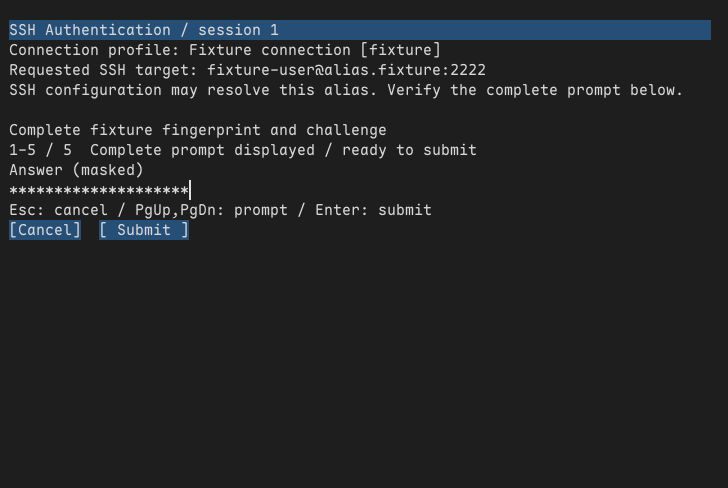

# 认证身份、可见控件与工作区路由候选

状态：完整请求身份、面板按钮/滚轮、等待时取消、Workspace的挑战代次与受保护通道已实现并在测试路径串联。工作区覆盖层目前仅Unix测试编译，普通发布构建仍无打开认证/SFTP的用户入口；独立SFTP工作器、共享队列和退出确认尚未接好。没有把候选实现或软件预览记为完整M6、系统焦点/输入法或三平台验收。

## 完整身份与审阅

[Identity](../../src/ssh/auth_identity.rs) 在连接创建时捕获不可变Profiles快照与索引，显示完整配置档名称/标识、请求的user@host:port，并明确SSH配置可能解析别名。未指定的用户/端口标为从SSH配置决定，不猜测当前用户或22；IPv6主机加方括号。名字中的控制和双向字符可见转义，字段内换行不能伪装新字段。它不访问配置文件/密钥、不解析系统SSH提示，也不把请求别名冒充实际已核验主机。

Identity在复制前按已验证字段的四倍展开加256字节静态余量、Data大小及128字节元数据预留；显示上限4096 B，所有权Arc共享。Backend::with_identity要求身份和挑战使用同一账本；每个Prompt在原始16KiB/四倍转义上限外，追加最多4096 B身份前缀。提示/换行索引的最大显示长度相应限为69632 B，未放宽SSH答案1023 B或原始提示16KiB限制。完整身份与服务器提示进入同一滚动/换行及实际绘制审阅范围；窄窗口不能凭截断标题同意。旧Profiles仍由原有额度拥有，配置重载不会就地更改正在认证的身份。

## 可见控件与等待取消

Panel使用固定三个命中槽；Cancel、Secret Submit和Confirm Reject/Agree只在对应文字完整绘制后发布区域，Agree/Submit还须当前提示末尾已绘制。小窗口/重排/组合等门禁继续由Panel/Editor核对，未绘制的区域不能触发操作。左键按下捕获完整view token、动作和矩形，释放须同一视图/几何/位置；失焦、缩放、换挑战使半次点击失效，NaN/无穷坐标拒绝。滚轮只作用于面板，保留有限小数余量，每次最多20行，不把滚动本身当审阅完成。

提交后没有编辑器时，Controller绘制一个可点击Cancel；稳定Waiting同步不会清掉刚绘制的区域。macOS阻塞描述符也允许**仅Cancel**的零载荷命令，NSView在聚焦且阻塞时将Esc放入固定单槽、合并唤醒，经原通道交付；不重启IME、不分配文字、不回落终端。切源/失焦清掉该槽，取消仍核对旧源完整身份和账本，不能取消下一挑战。其他阻塞命令/文字保持拒绝；每批含取消在内仍最多四项。鼠标取消/原生取消使宿主明确移除覆盖层，普通输入才恢复。

## 工作区归属和画布

[工作区模块](../../src/workspace/authentication.rs) 为新的独立连接分配不回绕的auth_generation，独立于字体/渲染generation，拒绝未登记的0代次和溢出。打开面板要求活动窗格、未结束会话、当前连接代次和同一Profiles快照/索引；后台请求应由后续队列保留待处理状态，不能直接调用打开接口抢焦点。切窗格、重连新ID、关闭或更换配置档使旧面板失效。失效后的当前输入也清理/丢弃，不能在移除旧面板的同一次回调中送进新终端。

Workspace候选覆盖App的protected_context/protected_input、普通事件路由、剪贴板请求、IME位置、分片tick与绘制。模态期间终端focus保持关闭，真实窗口focus另存并交给Controller；关闭后恢复。覆盖层复用已有单窗格或工作区画布，无新全窗口像素副本；撤销时失效原画布拥有者的绘制状态，防止切窗格后留下旧覆盖层像素。覆盖层对象另按size_of加128字节收费；没有新增线程、进程、包或固定刷新定时器。排版未完成才请求立即推进，脏画面沿用帧节奏，截止时间与原PTY/字体/持久化截止时间取较早值，不覆盖原有调度。

认证开始前已经在途的普通粘贴设置丢弃屏障，即使面板关闭后才返回也清理；新的普通请求仍遵守原单在途目标。迟到ProtectedPaste只释放自己的拥有者，不清掉无关的新普通paste_target。这项默认丢弃修正也适用于普通发布构建。三平台原生来源仍须分别接入，当前Unix工作区候选不等于Linux系统输入法或Windows可运行UI。

## 验证范围与预览

新增2项身份测试、1项便携指针交互测试和3项实际Unix工作区测试，覆盖同池/错池、不可变配置、最大提示+身份、未解析字段/IPv6、旧点击/缩放/下一挑战、等待取消、真实工作区/本地cat的输入隔离、零代次/溢出、源切换及两类迟到粘贴。工作区测试使用本地测试终端和内存Backend，不连接SSH、不读取系统剪贴板；由App真实路由到实际Controller/Panel/Backend。没有SFTP工作槽、通知交付或后台退出确认结论。

预览由实际工作区测试在公开夹具答案输入后、提交前导出Framebuffer，仅含掩码。已查看布局：完整请求身份、提示、掩码、帮助及按钮无重叠/裁切；它不是Window.present或系统输入法截图。

真实Cocoa桥接也加入捕获身份和阻塞时Esc：原生NSView回调→Controller/Panel/Backend、掩码软件绘制、旧粘贴/旧client、默认拒绝/明确同意、等待阻塞和取消分别验证。该程序仍用夹具显式传入聚焦状态；JSON的system_focus_verified=false保留，先前[真实系统激活限制](m6-sftp-auth-ime-window.md)未关闭。工作区测试和原生桥接是两段证据，不能相加声称完整Window.run/真实SSH/工作区UI链路已通过。

两工具链桥接均为：普通按键1、有归属输入9、合并唤醒1、旧client交付0、旧粘贴拒绝1、默认拒绝1、明确同意1、等待阻塞2、阻塞时取消1、最终额度0。[当前](m6-sftp-auth-workspace-native-bridge.json)、[Rust1.88](m6-sftp-auth-workspace-native-bridge-msrv.json)。预览PNG为36315 B，SHA256为`c40260f993a1e0e5dd1767fa6aa3dad1e7964430972eb5fa913043a0fe75fa4b`。

## 内存与组件耗时

[分配探针](../../tools/check_auth_allocation.py) 的Controller负载现在包含由预初始化Profiles生成的完整身份：标识64 B、名称128 B（含双向字符）、主机255 B、用户128 B、端口65535，再加16KiB控制字节的完整转义提示、两个索引重叠和1023 B在途粘贴/答案。身份String/Arc、前缀和增加的索引均在计量内；已有Profiles自身、字体/画布及共享控制上下文先预热且在计量外。它没有运行Workspace/PTY或网络，不是整个工作区资源准入证明。

当前工具链和Rust1.88十点一致：

| 阶段 | Rust请求存活 | 请求峰值 | 账本存活 | 账本峰值 |
| --- | ---: | ---: | ---: | ---: |
| 创建身份/提示/面板/首个索引 | 337398 B | 337398 B | 344085 B | 344085 B |
| 旧/新索引重叠 | 603214 B | 603214 B | 610157 B | 610157 B |
| 最大粘贴在途 | 338501 B | 603214 B | 345348 B | 610157 B |
| 失焦、保留提示/身份和在途副本 | 70639 B | 603214 B | 72255 B | 610157 B |
| 新view、旧粘贴仍在途 | 338501 B | 603214 B | 345348 B | 610157 B |
| 提交答案已取走/释放，连接身份仍保留 | 2980 B | 603214 B | 4412 B | 610157 B |
| 全部模型/结果释放 | 0 | 603214 B | 0 | 610157 B |

逐点请求存活/峰值有额度覆盖，旧粘贴、共同输入String和提交答案三次释放前清零通过，0失败。[当前](m6-sftp-auth-workspace-allocation.json)、[Rust1.88](m6-sftp-auth-workspace-allocation-msrv.json)。早期名称126 B的探索结果另存before-exact-name-boundary，最终使用精确128 B边界。

200次暖“有归属输入→Controller→包含完整身份的软件绘制”，100个单字节提交各产生一个必要解码String、100次删除命令不分配载荷，总计100分配、0扩容、净存活0；两个模型/渲染账本存活不增加。当前/Rust1.88的P50/P95/P99/最大为132/144/149/150 µs、132/144/145/146 µs；其中解码/控制器段为167/250/333/1333 ns、167/250/333/458 ns，保留200点排序样本并使用nearest-rank。完整身份使绘制负载比上一轮短提示更长，不据此计算同负载退化或优化幅度。真实按键、输入法、NSEvent调度、冷缓存、Window.present和RSS仍不在范围内。

原生四槽/保留旧context探针继续为请求峰值5459 B、账本12535 B、4次释放前清零；直接原生回调到Editor的请求峰值3989 B、账本15877 B、5次清零，均最终0。后者比上一轮增加8 B，来自Backend Body新增可选身份引用，额度随size_of一并覆盖。[对象当前](m6-sftp-auth-workspace-native-lifetime.json)、[对象Rust1.88](m6-sftp-auth-workspace-native-lifetime-msrv.json)、[Editor当前](m6-sftp-auth-workspace-native-editor.json)、[EditorRust1.88](m6-sftp-auth-workspace-native-editor-msrv.json)。固定TLS取消槽没有新堆载荷，静态段/栈和C/ObjC/OS内部副本不在Rust堆计量内，不能宣称完整原生堆硬上限。

默认debug/release各437通过/27忽略，可选原生后端各446通过/29忽略；本机默认/原生和Linux/Windows默认all-target Clippy、Rust1.88原生release测试编译、默认生产release构建共10项通过。[最终回归](m6-sftp-auth-workspace-build.json)。审计后补验未登记0代次及溢出，初次通过记录单独保留[此前版本](m6-sftp-auth-workspace-build-before-generation-zero-check.json)。Windows/Linux交叉检查不代表其原生GUI运行；工作区候选只在Unix测试编译，普通平台路径新增固定状态检查的真实GUI成本也未宣称为零。

## 后续

接独立SFTP工作器和有结束确认的生命周期，再实现全局16MiB、2活动/64等待以及上级预算锚定、目录/传输UI与通知；之后才启用可发布入口。Windows私有IPC/原生输入来源、真实密码/多因素和各平台IME、完整资源准入及GUI尾延迟、M7/M8、三平台/长测继续保持原范围。
