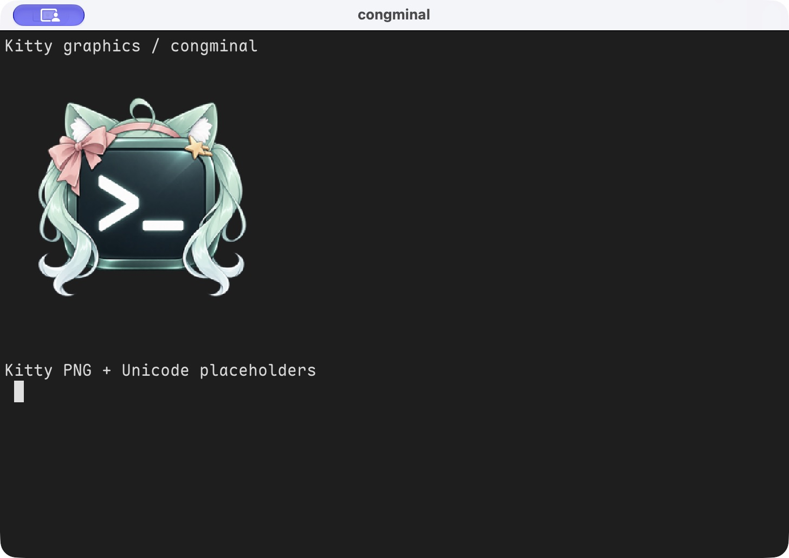

# v0.2.0 图片、图标与 Windows 后端验收

实现基线：`3dce190e8fa6e87eb04bf8ffd6d2dfb06b81a2d4`，随后补输入结束回收、超时回收和本记录。原有 v0.1.0/v0.1.1 证据保留原始版本，不覆盖。

## 三平台路径

[CI 41043921430](https://github.com/YoisakiKnd/congminal/actions/runs/41043921430) 的 macOS、Linux、Windows 原生检查和 Rust 1.88 四目标检查全部通过。[独立认证验收](https://github.com/YoisakiKnd/congminal/actions/runs/41043921379) 的三平台 SSH/SFTP 检查也通过。

三平台均通过生产 PTY 启动隔离测试子进程，完成 Kitty 查询、终端应答、分块 RGBA、Unicode 占位符/附加符及正常退出；Windows 强制检查使用附带的现代后端。真实 `ratatui-image 11.0.6` 夹具按 17 字节碎片输入，解码的 65536 个 RGBA 字节及 128 个占位格的图片 ID、行列与原始数据一致。该库版本来自 NakuruMusic 当前依赖；这不等于实际登录 NakuruMusic 播放服务做过端到端测试。

macOS 额外运行打包应用，通过 `tools/kitty-demo.py` 发送角色图标 PNG，人工核对透明像素、颜色和占位符显示。截图如下；不是字体块回退。

图标分别进入 macOS ICNS/应用资源、Windows EXE 资源/窗口大小图标、Linux `_NET_WM_ICON` 与 XDG 桌面入口。Linux 包提供用户级安装脚本，不需管理员权限。

## 内存边界

- 单条 APC 输入最多 5120 B，Base64 内容最多 4096 B；累计分块最多 16 MiB。超限、坏 Base64、取消和未知传输拒绝；输入结束立即释放未完成分块和包缓冲，已缓存图片保留用于回滚。
- 未完成分块在 30 秒后遇到下一批终端输入时回收；没有额外定时线程。完全无输入时由终端关闭/输入结束回收，不能理解成严格 30 秒壁钟释放。
- 图片最多 4 Mi 像素，宽高各最多 16384；缓存最多 16 张、16 MiB 实际 RGBA 容量，淘汰最早传入的图并清除对应放置。放置最多 32 项。解码与原缓存重叠的临时内存仍受共享预算约束，16 MiB 缓存额度不代表整个流水线峰值。
- `Cell` 仍为 20 B；借用原 marks 索引高位存放图片放置色索引，低 17 位保持原附加符索引。256 项颜色表只增加不重用，防止历史内容被新图片重定向；耗尽则隐藏相关占位符。RIS 清空历史和颜色表后重新开始。
- 暖绘制复用帧缓冲，不建立每个缩放尺寸的图片副本。PNG/RGB 解码、缓存和输入容量进入资源账本；账本不是操作系统 RSS 上限。

## Windows 依赖选择与实测

系统旧 ConPTY 在真实测试中丢弃 APC；仅改解析器不能修复 Windows。采用微软官方 NuGet `Microsoft.Windows.Console.ConPTY 1.25.260930003`，自写小型动态 API 适配，替换原控制台宿主。没有新增 Rust 运行时包、后台服务或下载线程。

版本、下载地址、包与成员 SHA256 固定于 `ci/conpty-runtime.json`。发布 CI 校验 NuGet 签名和固定哈希；仅复制匹配的 `conpty.dll` 与 `x64/OpenConsole.exe`，随包保留 MIT 许可和第三方声明。只从主程序目录加载 DLL，依赖查找限该目录和 System32。缺少整套运行时的源码开发构建回退到系统 ConPTY；存在但损坏的运行时报告错误，不静默换用不匹配宿主。

原始数据：[conpty-cost.json](conpty-cost.json)。Windows runner 上隔离测试父进程、其子测试进程与观察到的控制台宿主合计，5 轮交替 A/B；每轮启动后空闲 2 秒，约 50 ms 采样。该样本使用 debug 测试程序，比较后端更换的相对成本，不能当成 release 应用整体占用或输入延迟。

| 指标 | 系统 ConPTY | 附带 ConPTY |
| --- | ---: | ---: |
| 启动到子进程 ready，中位数 | 33.078 ms | 24.345 ms |
| 进程树工作集峰值，中位数 | 23,584,768 B | 26,882,048 B |
| 进程树私有内存峰值，中位数 | 4,288,512 B | 5,046,272 B |
| 观察到的线程峰值 | 27 | 19 |
| 观察到的进程峰值 | 3 | 3 |

两个原生文件未压缩总计 1,208,984 B（约 1.15 MiB）。代价为进程树工作集峰值中位数增加约 3.1 MiB、私有内存增加约 0.72 MiB。每轮第 0.3–1.7 秒的相同 PID CPU 时间差均为零；Windows 时间计数分辨率有限，这只能表示未观察到空闲 CPU 增量。没有声称零成本、所有机器更快，也没有完成新后端 30 分钟或多会话压力验收。后续升级需重测；旧系统后端无法实现这次要求的图片能力，因此保留此明确的资源代价。

## 绘制实测

[kitty-render-cost.json](kitty-render-cost.json)：本机 macOS arm64，release 软件渲染器，真实 ratatui 夹具，80×24 格、每格 9×20 像素，暖机 16 帧后连续强制全屏重绘 500 帧。中位 79,667 ns、P95 96,959 ns；测量区间 UI 线程 Rust 分配/重分配均为 0。

复现：`python3 tools/measure-kitty-render.py --output /tmp/kitty-render-cost.json`。工具复制源码至隔离临时目录并注入仅测试的线程分配计数器；不修改或发布生产分配器。结果不包含上传/解码、原生窗口呈现、GPU、其他线程分配或进程 RSS，也不代表所有分辨率和平台。

## 支持范围

支持静态直接传输 `t=d`，RGB/RGBA/PNG、raw zlib、分块、能力查询、普通/虚拟放置、32 位图片 ID、裁剪、偏移、z 顺序、删除 `i/I/a/A`、安静模式。文件和共享内存传输、动画、相对放置及其他删除模式返回不支持。未宣称完整实现 Kitty 协议全部扩展。

Windows shell 未显式配置时优先固定本地位置的 PowerShell 7，然后 Windows PowerShell，最后 COMSPEC；不扫描 PATH 或启动探测进程。显式配置优先。`TERM`、`COLORTERM`、`TERM_PROGRAM` 默认与 Unix 一致，可由配置覆盖。
