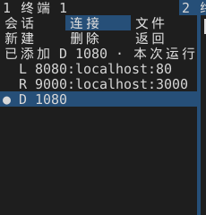

# M4：多会话工作区与布局持久化

更新：2026-10-21。已交付标签、分屏、会话侧栏、状态/通知侧栏及显式开启的布局持久化。本地目录浏览已接入；连接配置档已接入本地启动/SSH 元数据；完整全局资源账本仍未完成；字体映射、网格及缩放预留已接入，持久历史及其他未接入资源继续列在后续计划中。

## 操作

普通单终端沿用直接绘制路径；首次新建标签、分屏或打开侧栏时启用工作区。工作区在本次运行内保持启用。多个窗格共享字号、主题、字体加载器和字形缓存；每个窗格的 PTY、终端、历史、搜索、选区、命令状态、通知、复制任务和界面脏行独立拥有，不复制整份历史来切换焦点。

| 默认快捷键 | 动作 |
|---|---|
| Primary+T | 新建标签 |
| Primary+W | 关闭活动窗格；最后一个窗格关闭后退出 |
| Ctrl+Tab / Ctrl+Shift+Tab | 下一个 / 上一个标签 |
| Primary+D / Primary+Enter | 左右 / 上下分屏 |
| Ctrl+PageDown / Ctrl+PageUp | 下一个 / 上一个窗格 |
| Ctrl+Shift+PageUp / PageDown | 向左 / 右重排标签 |
| Primary+B / Primary+I | 切换左 / 右侧栏 |
| Primary+F12 | 显示整个工作区的分项资源快照 |

Primary 在 macOS 为 Cmd，其他平台为 Ctrl+Shift。可在 `[keybindings]` 中使用 `new-tab`、`close-pane`、`next-tab`、`previous-tab`、`split-right`、`split-down`、`next-pane`、`previous-pane`、`move-tab-left`、`move-tab-right`、`toggle-left-sidebar`、`toggle-right-sidebar` 覆盖默认绑定。

点击窗格或左栏会话行切换焦点，点击标签切换标签并恢复该标签上次活动窗格，拖动标签可重排。分隔线和侧栏边缘可拖动，尺寸更新按 40 ms 合并，鼠标松开时提交最新尺寸。状态栏显示活动窗格编号；左栏标记当前会话，右栏展示当前会话的 Shell 状态和最近通知。

达到最小尺寸时先隐藏放不下的侧栏，再将无法同时显示的分屏临时折叠到活动窗格。隐藏会话继续解析有预算的 PTY 输出，保留自身网格和选择/搜索状态，释放画布并暂停搜索扫描/绘制；放大窗口后恢复布局，不重新执行命令。后续切换到隐藏窗格时必要的尺寸变化可能使坐标型搜索/选区/命令范围失效，遵循 M2/M3 的失效规则。

启用过多会话后，已经退出的会话保留文本并显示“已结束”，释放 PTY/写入器，允许搜索、选择、复制和显式链接动作，拒绝新的终端输入。初始单会话自然退出仍沿用旧行为关闭窗口。新会话只执行配置中明确的 Shell 启动项，沿用配置的 working-directory，不把远程 OSC 7 路径猜作本地路径，也不重放旧输入。

## 本地目录侧栏

打开左栏后点击顶部“本地”，默认仍为会话列表。起点是 `[shell] working-directory`，未配置时为启动目录；不跟随 OSC 7，也不将远程主机路径解释为本地路径。点击文件夹进入，工具行提供上级、手动刷新和隐藏文件开关，滚轮支持小数位移。普通文件只选中；符号链接标记 `@`，不自动跟随。侧栏操作保持终端键盘/输入法焦点，不读取文件内容或向终端发送文件名。

单次最多显示 512 项、扫描 8192 项；达到任一上限标记“已达读取上限”，不是完整目录或分页。先按目录、再按原生文件名排序，只对已读取部分排序。控制字符替换后显示，导航仍使用原始原生路径。路径最多 16 KiB、单名最多 1024 编码字节；超限项跳过并提示部分不可读。

仅首次使用创建一个后台槽，最多一项运行、一项最新待处理和一个结果；不轮询目录、不建立监视器。关闭侧栏、缩窄隐藏、切换会话立即失效并清除旧视图；正在系统调用的工作只能待调用返回后合作式取消，因此复用一个工作线程，避免重复开关积累线程。首次使用后该线程在条件变量上等待，不周期唤醒。3 MiB 保守工作额度在扫描前准入，返回列表按实际容量保留；隐藏及结果失效后释放。系统 read_dir 内部和线程元数据仍不属于完整受管堆计量。

权限、路径、额度及任务错误明确显示，不自动重复请求；失败目标保留受管路径，刷新重试该目标。目录/滚动/隐藏模式不跨启动保存。测试和成本见 [评估](evaluations/m4-directory.md)，实际软件渲染画面见 [预览](previews/m4-files.png)。

## 连接配置档

左栏“连接”页读取 `[connections.<id>]`，最多 16 个，显示本地/SSH、分组和名称；滚轮可访问短栏中看不到的条目。点击本地配置档新建标签，覆盖该会话的 program/args/working-directory，保留其余配置。旧会话保留启动配置快照，热重载不改变已运行的程序；本地目录页采用该会话实际配置的起点。示例见 [配置模板](../assets/congminal.example.toml)，边界和内存成本见 [评估](evaluations/m4-profiles.md)。

### 转发规则页

连接页按钮行的第三格是 `转发`，打开当前窗格所用配置档的转发页（左栏接管，页签仍是“连接”）：

- 按钮行 `新建` / `删除` / `返回`（窄栏降级为 `新` / `删` / `返`）；下面一行是提示或输入，再往下是规则列表，选中行前有 `●`，行内写成 `L 8080:localhost:80` / `R 9000:localhost:3000` / `D 1080`。
- `新建` 或直接打字打开输入框，输入 `[L:|R:|D:]` 前缀加规则正文，回车追加；不写前缀按本地转发（`L`），前缀大小写不敏感。三类规则：
  - `L:` 本地转发（`ssh -L`）：`[绑定地址:]端口:主机:端口`；
  - `R:` 远程转发（`ssh -R`）：`[绑定地址:]端口:主机:端口`，远端监听、连回本地目标；
  - `D:` 动态转发（`ssh -D`，SOCKS）：只写 `[绑定地址:]端口`，没有目标主机段。
- 校验与配置解析同一套（`ForwardKind::accepts` → `forward_valid` / `dynamic_forward_ok`：只允许字母数字与 `.:_-[]`、不超过 128 字节、不以 `-` 开头；`L`/`R` 至少三段且端口可解析，`D` 最多两段且端口为 1–65535），非法输入只提示、不落库；重复规则被拒；三类合计最多 16 条。
- `删除` 需要选中一条并点两次（10 秒窗口），第一次只在行尾写“待确认删除”。
- `Esc` 先关输入框，再按一次关页面；`↑`/`↓` 在规则间移动选中。
- **改动只作用于本次运行之后新建的连接**：转发页维护的是一份工作副本（按类型拆成 `Forwards { local, remote, dynamic }`），关闭时记成“本次运行的覆盖”，之后从连接页点这个配置档会用 `Profiles::with_forwards` 复制一份改过的配置去连接（`Request.edited` 让迟到的准备结果仍按选中窗格判断有效性）。配置文件里的 `forward`/`forward-remote`/`forward-dynamic` 原值不动，已有窗格也不受影响。
- 只对“当前窗格用的是配置列表里的 SSH 配置档”开放：本地窗格、按 `~/.ssh/config` 别名临时合成的连接都会提示原因后不打开。
- 输入框按 `Kind::Sftp` 租借 `128 + 256` 字节额度，随页面一起释放；不新增线程与子进程。

三类规则在页面上的样子（230×240，`L` 本地、`R` 远程、`D` 动态，最后一条选中）：



### 系统 SSH 配置里的别名

配置里写了 `[ssh]` 分组（示例配置已包含）时，应用会读一次 `config-file`（默认 `~/.ssh/config`，最多读 256 KiB），把 `Host` 行里能直接当主机名的名字列在连接页配置档下面，点一下就用这个别名新建 SSH 连接：

- 只认 `Host` 行里不含 `*`、`?`、`!`、不以 `-` 开头、没有控制字符的名字；`HostName`/`HostKeyAlias` 这类长关键字不算。去重、按出现顺序、最多 32 条（`config::ssh::MAX_ALIASES`）。
- `HostName`、`User`、`Port`、`IdentityFile`、`ProxyJump`、`Match` 一律交给 OpenSSH 自己展开：应用只把别名当主机名传给 `ssh`，不解析、不复制这些设置，也不改写用户的 SSH 配置。
- `Include` 会跟进，语义与 OpenSSH 一致：相对路径按主配置所在目录（通常 `~/.ssh`）解析，`~` 换主目录，支持 `*`/`?` 通配（`*` 不跨目录），可以嵌套；别名按出现位置插入、全局去重。边界：嵌套最多 4 层（`MAX_INCLUDE_DEPTH`）、一次最多读 32 个文件（`MAX_INCLUDE_FILES`）、总字节数仍受 256 KiB 限制，按规范化路径去重所以自引用与互相引用都不会绕圈；`Include` 指向的文件不存在时直接跳过（与 OpenSSH 相同），不算错误。
- 点别名时按它临时合成一个配置档（host = 别名，program = `[ssh] program`），只挂在新窗格上，不写回配置、不出现在配置档列表里；结果落地前会检查这个别名是否还在列表里，配置重载后迟到的结果直接丢弃。
- 读文件在解析配置时做一次，不起线程、不起子进程；文件不存在时列表为空且不报警，读不了给一条警告。
- 未做：不做按别名的分组/主题、不显示 `HostName` 等实际参数、不展开 `Match` 块（`Match` 里的 `Host` 行同样按普通 `Host` 行处理，可能与 OpenSSH 的实际匹配结果不同）。

本地工作目录不展开 ~ 或环境变量，使用启动目录相对路径或绝对路径。配置中不接受密码或私钥内容，不读取密钥文件。SSH 现已接入 OpenSSH PTY，操作与验收边界见 [M5 记录](execution-m5.md)；theme 为关联元数据，按会话应用将在 M8 接入。布局文件不保存配置档或自动重连。

## 布局保存与恢复

在配置中加入（下次启动生效）：

```toml
[workspace]
restore-layout = true
```

默认关闭：不读取/写入布局、不创建布局任务线程，原单终端直接绘制路径保持可用。开启后在当前配置旁保存 `<配置文件名>.workspace`；例如 `congminal.toml.workspace`，`--config other.toml` 使用独立的 `other.toml.workspace`。相对路径在启动时固定到绝对位置，删除布局文件后下次从一个终端开始。配置热重载不会在当前窗口中启停持久化。

文件只含版本、标签/分屏树和顺序、各标签焦点、活动标签、侧栏开关及逻辑宽度（80–2048 逻辑像素）。不保存窗口位置/大小、终端文本、历史命令、未提交输入、标题、目录、环境变量或凭据。恢复时保留刚启动的首个会话，再逐轮新建当前配置的 Shell；当前 `[shell] args` 和 Shell 自己的初始化脚本仍会正常执行。不会重放历史输入，也不恢复旧进程。已结束的旧窗格在下次启动时同样作为新 Shell 打开。

布局在后台读取，解析前限制 4 KiB，只接受普通文件；解析限制 8 会话、15 树节点、8 层、连续且不重复的会话编号、有效焦点和 150–850 的分屏比例。未知版本、损坏、重复编号或超限时保留初始终端并提示，原文件不自动覆盖。启动前先验证可见网格和画布预算，每轮至多启动一个新会话；全部成功才提交布局并分配历史配额。中途失败或取消会释放已准备的新会话，保留原终端。窄窗恢复沿用临时折叠，不丢弃保存的树。

用户的按键、文字/预编辑、粘贴/复制、点击或滚动先取消迟到的恢复；单纯取消不会写回一个默认布局。若用户实际改变了布局，之后保存的是当前布局。后台结果不会抢走用户已开始操作的终端或焦点。

只在布局实际变化时构造小快照，普通 PTY 输出、键入和无拖动的鼠标移动不触发序列化或保存。400 ms 防抖后提交；一个专用线程最多保留一项运行写入、一项最新待写和各一个读取/保存结果，不累计历史快照。空闲用条件变量等待，无周期轮询。临时文件同目录独占创建，Unix 权限 0600，写入并同步文件、关闭句柄后替换旧文件；失败清理临时文件并保留旧布局。没有对目录执行同步，不保证断电后的最新状态；多个程序实例使用同一配置时以最后成功保存为准。

正常关闭窗口或最后窗格时立即提交仍在防抖期的变更。窗口退出后最多等待 250 ms，文件系统超时则不无限阻塞退出，最新变更可能未落盘；强制终止也可能丢失最近变更。macOS 菜单/Dock 的正常退出请求先交回 Rust 关闭路径，避免 AppKit 直接终止绕过保存。系统注销/关机的协商行为、Windows/Linux 原生退出和慢盘异常仍待真机验证。

开启持久化会增加一个线程、最多 4 KiB 的读取缓冲和少量有界元数据；恢复额外会话也有 PTY/线程和网格成本，继续受工作区 8 会话及分项预算约束。完整测量和限制见 [持久化评估](evaluations/m4-layout.md)。

## 输入、鼠标与剪贴板

- 平台窗口事件先定位窗格，再减去该窗格的物理像素原点，交给原有终端处理器。IME 候选区反向加回原点，极窄窗口下裁剪到窗口范围。
- IME 正在组合时不切换窗格，避免后续提交进入另一会话；组合确认/取消后可切换。搜索中的预编辑与终端预编辑仍隔离。
- 鼠标按下后由原窗格捕获拖动和松开，即使指针进入相邻窗格也不会转投。窗口失焦会取消拖动，并尽可能给原应用补发按钮释放。
- 粘贴请求记录发起会话 ID，之后改变焦点仍回到原会话；该会话关闭后丢弃迟到的回复。全窗口只保留一个正在读取的剪贴板请求，后续请求提示重试，不积压到未来执行。
- macOS/Windows 空剪贴板与 X11 失败回复都会结束本次请求。X11 INCR 多块传输尚未支持，不能把 8 MiB 的读取上限视为所有剪贴板协议都已兼容。外部 X11 所有者完全不响应时仍保留这个有界请求，不会把旧回复改投新会话；这是待真机补齐的外部协议场景，不以不安全的超时重定向代替关联。
- 平台读取剪贴板时即检查约 8 MiB 的 UTF-8 输入预算。Windows 在 GlobalSize 范围内寻找终止符，并在分配 UTF-8 文本前累计预算；X11 限制属性读取、拒绝不完整/非法 UTF-8 并清理属性；macOS 先检查 UTF-8 字节数。普通输出复制仍为分片 2 MiB 上限。

## 资源与调度

| 项目 | 本批实际接入的限制 |
|---|---|
| 会话数量 | 全工作区最多 8 个，包括已结束且尚未关闭的会话；超限不再启动 PTY |
| 回滚历史 | 启用工作区后共用 64 MiB，按会话数分配配额，同时保留配置的行数限制；成功新建会话可能淘汰旧历史，启动失败不调整旧配额 |
| 网格 | 每窗格最多 65,536 个逻辑格子，主/备用屏分配有界；大幅变窄时回收过大的旧行容量，避免累计所有历史宽度 |
| 画布 | 工作区最多 8,388,608 像素；主合成画布与可见窗格画布合计稳态容量约不超过 72 MiB，隐藏画布释放；扩容瞬时副本已接共享准入 |
| 字体与字形 | 全工作区一个 Renderer/字体集合/字体任务加载器，共用已有缓存分项预算；每窗格只保存独立 ViewState |
| 输入/输出队列 | 沿用每会话 8 MiB / 1 MiB 及条目限制，数量再受 8 会话上限约束；背压/取消继续沿用 M1 |
| PTY 调度 | 活动窗格优先，约 48 KiB / 750 µs；其他会话轮转，约 16 KiB / 200 µs；整轮约 4 ms 合作式预算，未完成扫描通过 deadline 继续，避免丢唤醒 |
| 搜索/复制 | 搜索只在可见窗格推进，复制保持一个窗格一个有界任务；每轮总预算共同约束前进，隐藏窗格不构造装饰或绘图 |
| 系统通知 | 仍默认关闭；同工作区共享工具闸门，最多一个辅助进程，每 10 秒最多一次；竞争请求留在应用内中心，系统请求不排队补发 |

这些是实际分项准入，不是“进程 RSS 一定低于 512 MiB”的承诺。字体文件映射、缓存索引、分配器高水位、重排/扩容瞬时缓冲和外部进程都须单独记录。M4 完整的 512 MiB 全局账本与跨模块所有权准入仍在后续计划内。

共享账本现已接入画布（含扩容峰值）、队列容量预留、字形缓存计费、字体堆回退、独立映射额度、主/备用网格及缩放工作集预留；默认混合额度 512 MiB，未覆盖持久历史及全部临时缓冲，详见 [准入说明](execution-m4-memory.md)。它不是完整堆或 RSS 上限。

两个关键所有权规则：窗格借入驱动器只交换状态和画布，不复制终端或字体；配置/字体变化通过 Renderer 代次使各 ViewState 按需失效。普通数据更新只合成对应画布的脏像素行；隐藏标签不渲染。显式链接/系统通知的完成或取消释放工作线程，已结束窗格仍推进查询/复制等 UI 任务，避免等待结果导致空转。

## 历史重排优化

常见硬行直接将旧行缓冲移交给结果，缩放只在确有需要时精确扩容，避免 80→81 列触发 Vec 翻倍。重排逐条消耗逻辑行，已处理的旧存储及时释放，不再保留完整逻辑行集合直到输出构造结束。大幅缩小时回收过大的行容量。

软换行、宽字符、光标 pending-wrap、空白中的光标与屏幕顶端语义由 1200 组确定性随机案例对照原重排算法验证；原算法只在测试参照文件中编译。本机常见硬行的收益见性能记录；单条巨大的软换行逻辑行仍需临时缓冲，不能把硬行结果外推到全部文本。

## 验证与待办

本机真实 PTY 测试覆盖多会话输出隔离、关闭/结束保留、标签切换/重排、搜索与 IME、跨窗格鼠标捕获、分隔线只调整受影响的终端、侧栏/窄窗、异步粘贴归属/失败/关闭、安全读取预算、8 会话拒绝与启动失败。资源和性能原始数据见 [M4 本机评估](evaluations/m4.md)，实际 Renderer 帧见 [四窗格预览](previews/m4-workspace.png)。

完整 512 MiB 全局资源账本仍未完成。SSH 进展与剩余项见 [M5 记录](execution-m5.md)。布局持久化的 Windows/Linux 真机、慢盘/断电及长时间验证仍未完成。尚未验收：三平台 GUI/输入法组合、真实外部剪贴板所有者的异常交互、系统通知真实送达/外部工具峰值、30 分钟压力与长软行的全局瞬时预算。交叉编译和本机短测不代替这些项目。


全局同步元数据待办补充：本地传输分配探针首次观察到进程创建静态Mutex冷初始化64B；独立标准库Mutex程序在当前/Rust1.88均复现1次64B存活，尚未全局收费。局部文件组件仅明确预初始化这一应用状态，不视作M4问题已关闭。见[诊断与范围](evaluations/m6-sftp-local-transfer.md)。


SFTP输入分项补充：Budget/Stats新增独立输入上限和计数（本机对象+16B），Lease仍24B，捕获使用64B固定TLS槽，无每票据新指针。候选子池元数据仍由父票据先准入，两工具链全线程/迟到拥有者回归通过；根预算对象、冷进程锁64B及其他全局元数据准入仍属M4余项，不把该分项当作完整堆/RSS证明。[证据](evaluations/m6-sftp-io-admission.md)。
